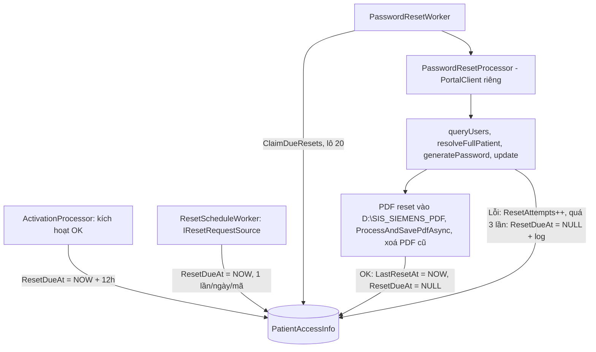

# Plan: Reset mật khẩu mặc định + luồng API reset (trạng thái hiện tại)

> Trạng thái: **đã code xong, build OK, đã test thật** (6 mã reset thành công, 48 ca kích hoạt được đặt lịch, không lỗi/cảnh báo).

## 1. Nguyên tắc
- Mỗi tài khoản **reset mặc định đúng 1 lần**, `DelayHours=12` sau lúc kích hoạt. Xong thì xoá lịch (`ResetDueAt = NULL`).
- Chỉ **một nơi** gọi portal để reset: `PasswordResetWorker`. Luồng API chỉ **đặt lịch** (`ResetDueAt = NOW()`).
- Không gửi email, không gửi SMS (SMS làm sau). Mật khẩu mới do portal sinh, PDF xử lý như lúc kích hoạt, lưu `TemporaryPassword`; không thêm cột mật khẩu.
- Ca kích hoạt trước khi triển khai: `ResetDueAt = NULL` → không bị reset.

## 2. Kiến trúc: 3 worker độc lập trong 1 service
| Worker | Việc | Chu kỳ |
|---|---|---|
| `ActivationWorker` | Lấy ca từ API SIS → DB → kích hoạt; sau khi lưu PDF/DB thành công gọi `ScheduleResetAsync(+12h)` | 2 phút |
| `PasswordResetWorker` | Nhặt ca đến hạn (`ClaimDueResetsAsync`) → `PasswordResetProcessor` reset | 2 phút |
| `ResetScheduleWorker` | Hỏi `IResetRequestSource` danh sách mã → `ScheduleResetFromApiAsync` (đến hạn ngay) | 2 phút |



- Reset dùng **`PortalClient` và phiên đăng nhập riêng** (không dùng chung Gate/semaphore với kích hoạt). Portal cho phép nhiều phiên cùng user, đã xác nhận qua test.
- Bỏ qua bước `isEmailUnique` ở luồng reset.

## 3. Portal (từ HAR `reset.vn.har`)
Nút "Tạo mật khẩu mới" gọi: `queryUsers` → `resolveFullPatient` (có `userId`, `prepareForUpgrade=false`) → `generatePassword` → `update` (`passwordResetRequired=true`, birthdate `...T00:00:00.000Z`). Request không có trường password; PDF base64 trả trong `data[0].content` + `fileName`.

## 4. DB (`PatientAccessInfo`, tự thêm trong `EnsureDatabaseSchemaAsync`)
`ResetDueAt`, `LastResetAt`, `ResetAttempts INT DEFAULT 0`, `ResetLockedUntil`, `ResetRequestedDate DATE`.

Hàm trong [PatientAccessService.cs](file:///d:/repo/SIS/SIS_WEBVIEW2/SIS_WORKER/PatientAccessService.cs): `ScheduleResetAsync`, `ScheduleResetFromApiAsync` (chống trùng theo ngày: `ResetRequestedDate IS DISTINCT FROM CURRENT_DATE`), `ClaimDueResetsAsync` (`FOR UPDATE SKIP LOCKED`, khoá 15 phút), `PreviewDueResetsAsync` (DryRun), `MarkResetDoneAsync`, `MarkResetFailedAsync`.

## 5. File code
| File | Vai trò |
|---|---|
| [PasswordResetProcessor.cs](file:///d:/repo/SIS/SIS_WEBVIEW2/SIS_WORKER/PasswordResetProcessor.cs) | Reset 1 ca; lưu PDF `{code}_reset_{yyyyMMddHHmmss}_{fileName}`; xoá PDF cũ `{code}_*.pdf` (trừ file mới) khi thành công; lỗi giữ PDF cũ |
| [PasswordResetWorker.cs](file:///d:/repo/SIS/SIS_WEBVIEW2/SIS_WORKER/PasswordResetWorker.cs) | Quét ca đến hạn, lô 20, `MaxPerCycle=0` (không giới hạn); DryRun chỉ log |
| [ResetScheduleWorker.cs](file:///d:/repo/SIS/SIS_WEBVIEW2/SIS_WORKER/ResetScheduleWorker.cs) | Đặt lịch reset từ danh sách API |
| [ResetRequestSource.cs](file:///d:/repo/SIS/SIS_WEBVIEW2/SIS_WORKER/ResetRequestSource.cs) | `IResetRequestSource` + `MockResetRequestSource` (đọc `ResetApi:MockPatientCodes`) |
| [PortalClient.cs](file:///d:/repo/SIS/SIS_WEBVIEW2/SIS_WORKER/PortalClient.cs) | `UserId`, `ResolveFullPatientAsync(forExistingUser)`, `GeneratePasswordAsync`, `ResetPasswordAsync` |
| [ActivationProcessor.cs](file:///d:/repo/SIS/SIS_WEBVIEW2/SIS_WORKER/ActivationProcessor.cs) | Đặt lịch reset sau kích hoạt thành công (trước gửi email) |
| [Options.cs](file:///d:/repo/SIS/SIS_WEBVIEW2/SIS_WORKER/Options.cs), [appsettings.json](file:///d:/repo/SIS/SIS_WEBVIEW2/SIS_WORKER/appsettings.json), [Program.cs](file:///d:/repo/SIS/SIS_WEBVIEW2/SIS_WORKER/Program.cs) | Cấu hình + đăng ký |

## 6. Cấu hình hiện tại
```json
"PasswordReset": { "Enabled": true, "DelayHours": 12, "PollIntervalMinutes": 2, "MaxPerCycle": 0, "MaxAttempts": 3 },
"ResetApi": { "Enabled": true, "PollIntervalMinutes": 2,
  "MockPatientCodes": [ "24978903", "22032825", "26772725", "26772727", "25039248", "26772729" ] }
```
- Không ghi comment trong `appsettings.json` (gây lỗi); giải thích key ở `CAU_HINH_APPSETTINGS.md`.
- Lỗi reset: thử lại tối đa 3 lần rồi dừng (xoá lịch + log lỗi).

## 7. Còn lại / việc sau
- **API thật**: viết class implement `IResetRequestSource` (cần URL, auth, JSON, tần suất) và đổi đăng ký trong `Program.cs`.
- **SMS** (chưa làm): chỉ gửi cho mã do API yêu cầu (`ResetRequestedDate`), không bao giờ cho reset mặc định; thêm cột `SmsSentAt` chống gửi trùng.
- Trước khi chạy thật: xoá `OverrideRecipientEmail` trong `email_config.json`; cân nhắc che mật khẩu trong log; thay danh sách mock.
